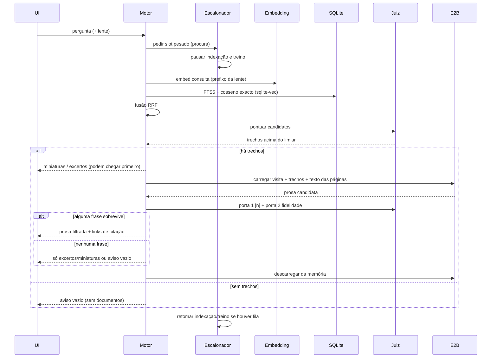
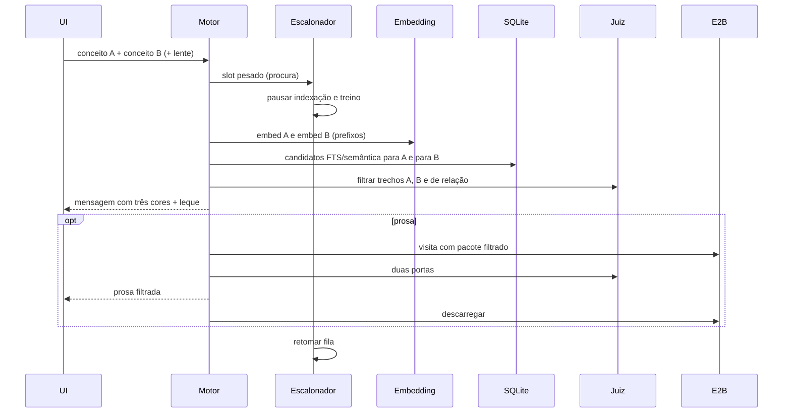
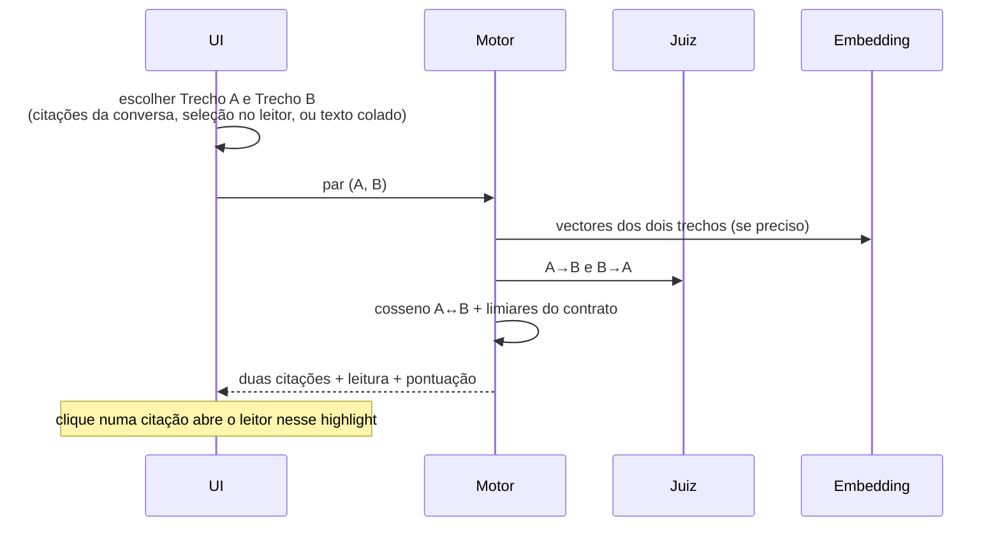
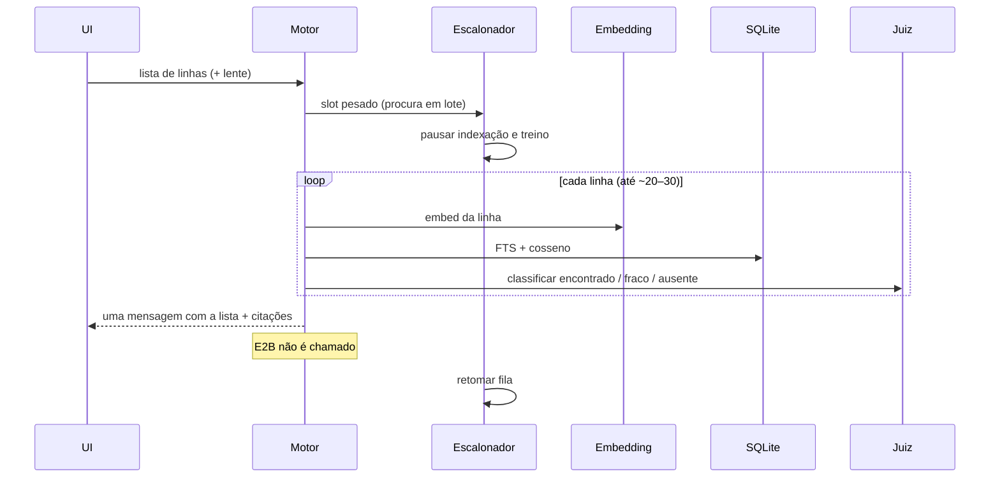
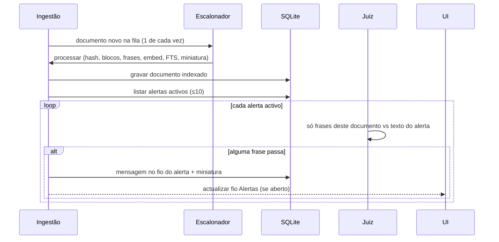

# Fluxos

Diagramas de sequência dos gestos principais. Actores comuns: **UI** (browser), **Motor** (Python em `127.0.0.1:4317`), **SQLite**, **Embedding**, **Juiz** (ONNX), **E2B**, **Escalonador**.

## Procurar

Modo de repouso da barra. Uma linha; Enter envia. Lente activa muda o prefixo EmbeddingGemma e a instrução de prosa do E2B.



## Correlacionar

Dois campos: Conceito A e Conceito B. Resultado: mensagem com três cores (A, B, relação) e o mesmo leque.



## Confrontar

Sem E2B. Sem modelo novo. Leitura = função das duas direcções do juiz e do cosseno entre trechos (concordam / contradizem-se / assuntos diferentes).



## Lacunas

Caixa multi-linha; uma linha por controlo/hipótese/pergunta. **Sem E2B.** Uma mensagem: encontrado / fraco / ausente. Não se repete sozinha.



## Alerta ao indexar documento novo

Criação do alerta: campo «O que queres que eu vigie?»; máximo dez. Documentos **antigos** não são revistos sozinhos. Só o documento que acaba de ser indexado.



## Fechar dossier

Botão explícito — não automático por mensagem. Fotografia no SQLite; **não** volta a correr modelos.

```mermaid
sequenceDiagram
  participant UI
  participant Motor
  participant DB as SQLite

  UI->>Motor: fechar dossier (chat actual)
  Motor->>DB: ler mensagens, frases que passaram as duas portas,<br/>trechos, offsets, caixas, scores
  Motor->>DB: SHA-256 actual de cada ficheiro citado
  Motor->>DB: versões EmbeddingGemma, juiz (± LoRA), E2B + data
  Motor->>DB: gravar fotografia imutável do dossier
  Motor-->>UI: dossier fechado
  Note over UI,DB: Reabrir lê a fotografia.<br/>Se hash em disco ≠ hash gravado → aviso «fonte mudou»; prova antiga mantém-se.
```

## Feedback imediato

Linha Acertou / Corrigir / Descartar. Não bloqueia a procura seguinte. Não altera o E2B.

```mermaid
sequenceDiagram
  participant UI
  participant Motor
  participant DB as SQLite

  UI->>Motor: Acertou | Corrigir | Descartar
  alt Descartar
    Motor-->>UI: sem treino; link discreto para corrigir mais tarde
  else Acertou
    Motor->>DB: marcar trechos mostrados como positivos do juiz
    Motor-->>UI: na hora: próximas procuras parecidas privilegiam confirmados
  else Corrigir
    UI->>UI: abrir leitor, seleccionar trecho correcto
    Motor->>DB: marcas desta resposta → negativas; selecção → positiva
    Motor-->>UI: reordenação imediata entre candidatos já recuperados
  end
  Note over Motor: Não se injecta texto no escritor.<br/>LoRA só quando a máquina está livre (fluxo seguinte).
```

## LoRA quando a máquina está livre

Rank 8, LR baixo, puxão para o base. ≤ 2 núcleos. Se o hold-out piorar, a troca é rejeitada. Até exportar ONNX novo, a procura usa o ONNX anterior.

```mermaid
sequenceDiagram
  participant Esc as Escalonador
  participant Train as Treino LoRA
  participant DB as SQLite
  participant ONNX as Juiz ONNX activo

  Esc->>Esc: sem procura activa; fila pesada livre
  Esc->>Train: iniciar LoRA (≤2 núcleos)
  Train->>DB: carregar correções (locais + importadas confirmadas)
  Train->>Train: PyTorch temporário; treinar a partir do base
  alt hold-out não piora
    Train->>ONNX: exportar ONNX novo; activar
    Train->>Train: libertar PyTorch da memória
  else hold-out piora
    Train->>ONNX: rejeitar troca; manter ONNX anterior
    Train->>Train: libertar PyTorch
  end
  Note over Esc: Se chegar uma procura, o escalonador pausa/cancela<br/>o treino conforme a política de «procura tem prioridade».
```
