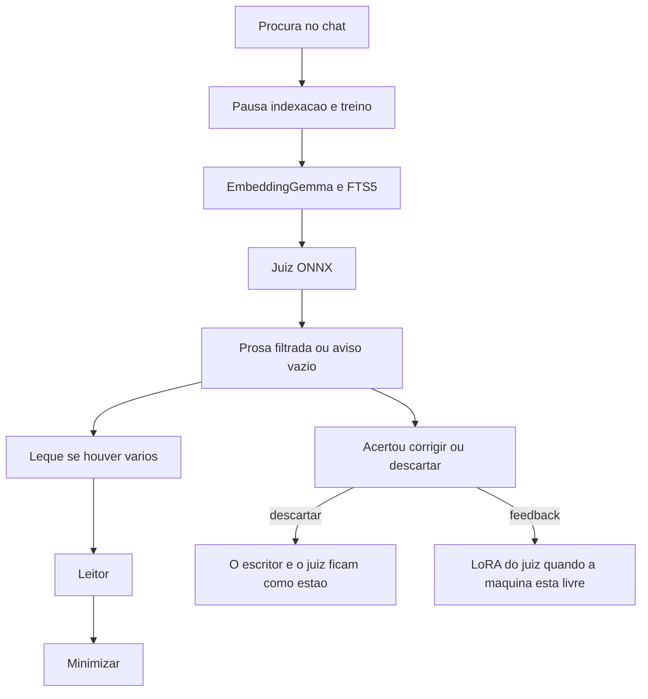

# Lente — um chat de pesquisa com prova na página

App de secretária no browser. Windows, macOS e Linux. Alvo: 16 GB de RAM, com ou sem GPU, sem a máquina ficar presa. A GPU, se existir, acelera o mesmo código. Não há um segundo modo.

## Que modelo faz de System One

O Jev (`jev-1.14.0`) é o System One da TypeSafe e só existe na API deles. Não há pesos para instalar. Um clone local ou traz um Qwen de cerca de 4B (perto de 9 GB) ou um DeBERTa grande (perto de 1 GB), os dois por cima dos modelos que a app já carrega. Isso é o que faz um portátil de 16 GB arrastar.

O papel de System One aqui é decisão rápida, sem prosa: esta frase responde ou não. Quem o faz é o cross-encoder [`cross-encoder/mmarco-mMiniLMv2-L12-H384-v1`](https://huggingface.co/cross-encoder/mmarco-mMiniLMv2-L12-H384-v1), 118M, Apache 2.0, treinado em mMARCO (inclui português). No dia a dia corre o ONNX int8 já publicado desse modelo, cerca de 120 MB. Não é o Jev e não traz a calibração dele. A pontuação ajusta-se com o teu feedback, e só nesse modelo.

## Três papéis, dois residentes

- **EmbeddingGemma 2 (270M, só texto)** encontra. Vector de 256 dimensões, corte Matryoshka do de 768, depois normalizado. Fica congelado e residente. Visão e áudio não se carregam. Float32 em CPU, porque float16 produz NaN.
- **O juiz de 118M, em ONNX int8,** decide o highlight. Residente, leve. O PyTorch só entra para um LoRA depois de feedback, e sai da memória quando o treino acaba.
- **Gemma 4 E2B QAT Q4** escreve a resposta e fica congelado. Sobe para essa resposta, desce a seguir. Respostas anteriores não entram no prompt, nem como exemplo nem como fine-tune. O contexto de saída mantém-se o do modelo de base, mais os trechos desta procura.

Quem pinta o highlight é o código. Cada marca é um intervalo literal do ficheiro.

## Orçamento da máquina

Um trabalho pesado de cada vez. Uma procura pausa a indexação e o treino, e retoma-os no fim. Embedding, juiz e E2B deixam sempre pelo menos dois núcleos livres para o sistema e para a interface. O E2B, quando escreve, fica limitado a esses núcleos, para o chat continuar a responder ao rato. As miniaturas do leque são imagens pequenas feitas uma vez na indexação, não um PDF renderizado ao passar o rato.

Residente numa procura: sistema, browser, EmbeddingGemma em float32, juiz em int8, SQLite. O E2B é visita. Disco: cerca de 2 GB, 0,5 GB e 3 GB para os três. Não se descarregam os 11 GB de pesos de treino do E2B.

## Base vectorial

Não faz falta uma base vectorial à parte. O SQLite de origem não pesquisa vectores, mas guarda-os. A extensão `sqlite-vec` corre dentro do mesmo processo e escreve os vectores no mesmo ficheiro que o resto: documentos, FTS5, chats, feedback e dossiers. Sobrevive a reinícios. Uma cópia do ficheiro leva o índice consigo.

A pesquisa é cosseno exacto, não aproximada. Com milhares de documentos e vectores de 256 dimensões, o varrimento cabe em milissegundos e não salta um vizinho. A extensão oficial Vec1 do SQLite ainda está antes da 1.0 e usa um índice aproximado, que pode omitir o trecho certo. Não entra. Também não entram Qdrant, Chroma, LanceDB nem Postgres: seriam outro processo e mais memória.

Texto exacto e semântica fundem-se no código (fusão por rank recíproco) e o juiz continua a filtrar o que se marca.

## Dossier de prova

É o que distingue a app de um chat que esquece de onde veio a frase. Cada frase da resposta que passou as duas portas é um link. Clicar abre o leitor nessa página, com o highlight já à vista. Não é preciso passar pelo leque para seguir uma citação; o leque continua lá para escolher um documento à mão.

Quando a conversa te interessa como registo, fechas um dossier. O fecho grava, no mesmo SQLite, uma fotografia que não volta a correr modelos:

- perguntas e as frases que ficaram no ecrã
- para cada frase, o trecho literal, ficheiro, página, offsets, caixas do highlight e a pontuação do juiz
- SHA-256 dos bytes do ficheiro nesse momento
- data, e as versões do EmbeddingGemma, do juiz (incluindo o LoRA, se houver) e do E2B

Reabrir lê a fotografia. Se o ficheiro em disco tiver outro hash, o dossier mostra que a fonte mudou depois do fecho, e a prova antiga mantém-se. Exportar escreve um Markdown para ler e um JSON com os mesmos campos, para arquivo. Fechar é um botão, não um automático a cada mensagem.

## A barra de escrita

Tudo o que se escreve parte do mesmo sítio, no fundo do chat. À esquerda do campo há um botão `+`. Abre um menu curto, por cima da barra, em vidro. `/` abre o mesmo menu. As setas escolhem, Enter confirma, Escape volta a uma procura normal. O modo activo fica uma pastilha na barra, para se ver o que se está a escrever. Não há páginas novas para estes gestos.

- **Procurar**, o modo de repouso. Uma linha. Enter envia.
- **Correlacionar.** A barra parte-se em dois campos, Conceito A e Conceito B. Enter envia os dois. O resultado é a mensagem de sempre, com as três cores e o leque.
- **Confrontar.** Dois lugares, Trecho A e Trecho B. Cada um diz "escolher". Ao carregar, o chat escurece levemente e as citações e os trechos fixados desta conversa ficam clicáveis; escolhes um e o lugar enche-se com o ficheiro e a página. Se ainda não houver citações, o lugar aceita texto colado. Enviar pede ao juiz as três leituras do par: concordam, contradizem-se, ou falam de assuntos diferentes. A resposta no fio mostra as duas citações, a leitura, e a pontuação. Clicar numa citação abre o leitor nesse highlight. No leitor, com texto seleccionado, uma bolha "Confrontar" enche o primeiro lugar vazio e traz-te de volta à barra para escolheres o segundo.
- **Alerta.** A barra fica um campo só, com o placeholder "O que queres que eu vigie?". Enviar cria o alerta, até dez no total. Na barra lateral, por baixo das conversas, um grupo Alertas. Cada um abre um fio. Quando um documento novo acaba de ser indexado, o juiz olha só para as frases desse documento. Se alguma passar, cai uma mensagem nesse fio, com a miniatura. Documentos antigos não são revistos sozinhos. Desligar o alerta é um interruptor no topo desse fio.
- **Lacunas.** A barra cresce para uma caixa de várias linhas. Uma linha por controlo, hipótese ou pergunta. Shift+Enter parte a linha, Enter envia. Sai uma única mensagem no chat: uma lista com encontrado, fraco ou ausente. A citação de cada linha abre o leitor. Vinte ou trinta linhas de uma vez, sem o E2B, e não se repete sozinha.

A lente de trabalho (investigar, assessment, acreditação, verificar) é outra pastilha na mesma barra, ao lado do modo. Muda a instrução da procura, do alerta e das lacunas. Não muda o confronto, que já tem as três leituras fixas.

Exportar e importar afinações não entra neste menu. Não há texto para escrever. Fica no estado da aprendizagem, no topo da barra lateral: Exportar correções, Importar correções.

## Mais, ainda sem peso

- SHA-256 calculado na ingestão. Se o ficheiro mudar no disco, a biblioteca marca-o como desactualizado em vez de responder com um índice velho em silêncio.
- Diário local, só de acrescentar: procuras, documentos abertos, feedback, fechos de dossier. Não há contas nem rede.
- Etiquetas nos documentos, postas por ti, para filtrar a biblioteca. A sugestão de tipo por embedding que já existe continua a ser só uma sugestão.
- Uma acção de cópia de segurança: a pasta `data/` num zip, no sítio que escolheres. Sem nuvem.

## O chat e o leitor

Barra lateral em vidro: conversas, nova, renomear, apagar. A primeira procura dá o nome.

A resposta traz prosa presa aos trechos, ou o aviso de que não há nada acima do limiar, e nesse caso não há documentos. Quando há, uma miniatura por documento, na página do primeiro highlight. Um documento: o clique abre o leitor. Vários: o rato abre um leque ainda em miniatura; clicas na que queres; essa cresce até ao leitor. Minimizar, ou Escape, recolhe o leitor até à miniatura e o chat continua no mesmo sítio. Em tacto, o primeiro toque abre o leque e o segundo abre o documento. `prefers-reduced-motion` encurta o movimento sem tirar o leque nem o leitor.

O leitor abre o documento inteiro. PDF, texto, Markdown, página de URL ou imagem.

- Scroll contínuo, highlights em todas as páginas atingidas, salto entre marcas
- Zoom, arrastar numa imagem ou num scan, ajustar à largura e à página
- Páginas, ir para uma página, procurar neste documento
- Sumário com os títulos extraídos na indexação
- Seleccionar, copiar, e copiar a citação já com ficheiro e página
- A selecção serve para corrigir o highlight
- Fixar um trecho na mensagem, uma linha no SQLite, para o encontrares ao reabrir o chat sem nova procura

Superfície do texto sólida, com serif. O chrome segue em vidro. Animações curtas: mensagem, miniaturas, leque, crescer até ao leitor, highlight a acender uma vez, recolher.

## A resposta, sem reaproveitar respostas velhas

O E2B vê os trechos que o juiz deixou passar nesta procura, com ficheiro e página, e o texto dessas páginas. Se o leitor estiver aberto e a pergunta for sobre essa página, essa página entra também. Não vê a biblioteca inteira. Não vê a prosa que escreveu antes. Não vê exemplos de respostas confirmadas.

As tuas perguntas anteriores no mesmo chat servem só para completar uma procura de seguimento ("e o controlo de acessos?"). Essa frase reescrita vai à pesquisa. Não volta a ser mostrada como se fosse conhecimento, e a resposta nova tem de citar trechos desta volta.

Duas portas:

1. A frase acaba com `[n]` de um trecho que estava no pacote. Sem isso, sai.
2. O juiz compara a frase com o trecho citado. Se não for fiel, sai.

Se nenhuma frase sobreviver, ficam os excertos e as miniaturas, ou só o aviso de vazio. As miniaturas aparecem primeiro.

## Feedback, só no juiz

Linha pequena: Acertou, Corrigir, Descartar. Não bloqueia a procura seguinte. Descartar não treina nada. Um link discreto fica na mensagem para corrigir mais tarde.

- Acertou marca os trechos mostrados como positivos do juiz.
- Corrigir: procuras, abres o leitor, seleccionas. As marcas desta resposta ficam negativas; a selecção fica positiva.

Isto não muda o E2B. Muda a ordenação e o limiar dos highlights:

- Na hora, uma pergunta muito parecida privilegia trechos confirmados e desce os rejeitados, entre os candidatos que a pesquisa já trouxe. Não se injecta texto no escritor.
- Quando ninguém está a procurar, um LoRA rank 8 do juiz rejoga todas as correções, com learning rate baixo e puxão para o modelo base. Dois núcleos no máximo. Se as correções deixadas de lado piorarem, a troca é rejeitada. No fim, exporta-se de novo o ONNX e o PyTorch sai da memória. Até lá, a procura usa o ONNX anterior.

## Juntar afinações

Faz sentido partilhares o que o juiz aprendeu. Não faz sentido somar os ficheiros de pesos e esperar um decisor dez vezes melhor. Dez adaptadores LoRA treinados em sítios diferentes, se forem médios, interferem uns com os outros. Pesquisas repetidas sobre o mesmo tema também não multiplicam o sinal. O que empilha é o conjunto de correções: dez pessoas com cinquenta correções úteis dão até quinhentos exemplos, e um único treino em cima do modelo base aprende com todos. Fica melhor nesses tipos de pergunta. Não fica dez vezes mais certo.

O ficheiro que se exporta é isso, não o binário do LoRA. JSON com a versão do formato, o id do modelo base, e cada correção: pergunta, trecho, etiqueta, lente, e um hash do par. Os trechos são texto dos documentos. Quem exporta está a entregar essas frases. O ecrã de exportação diz-o.

Importar mostra a contagem, as lentes e um punhado de perguntas, e só treina depois de confirmares. Pares repetidos entram uma vez. Um ficheiro de outro modelo base é recusado. O treino é o mesmo de sempre: parte do base, junta as tuas correções e as importadas, corre quando a máquina está livre. Um ficheiro malicioso pode tentar ensinar o juiz ao contrário, por isso nada se aplica antes da confirmação.

## Pesquisa, sem modelo a mais

- FTS5 no mesmo SQLite apanha o termo exacto: número de cláusula, CVE, sigla, identificador. Os candidatos juntam-se aos do embedding. O juiz continua a ser quem deixa passar o highlight. Um código escrito à letra marca-se mesmo quando a semelhança semântica for média.
- Prefixos do EmbeddingGemma: documento `title: {título} | text: {conteúdo}`; investigar `task: question answering | query: …`; verificar `task: fact checking | query: …`; pesquisa curta `task: search result | query: …`.
- O limiar é visível. Com correções suficientes, a escala de Platt calcula-se nos teus exemplos.
- Correlacionar, na barra de escrita: cor para A, cor para B, cor para a relação. Os documentos entram no mesmo leque.

A lista da biblioteca é virtualizada, para milhares de ficheiros não pesarem na interface. O tipo de documento é um filtro manual, com sugestão pela semelhança do embedding que já existe.

## Entradas

- Texto colado, Markdown, `.txt`, `.docx`
- PDF com texto e caixas
- PDF digitalizado e imagens, via Tesseract, a única dependência de sistema
- URL do artigo, com recusa de endereços privados

SQLite com `sqlite-vec` e FTS5 em `data/`. Hash, fila de um documento, blocos de cerca de 500 tokens, frases com offsets e caixas.

## Interface

Português. Vidro líquido no chrome: fundo escuro neutro, blur, bordo de luz, transparência. shadcn/ui reestilizado, mais motion. Geist no chrome, serif no leitor. Exportar prova em Markdown: perguntas, frases citadas, ficheiro e página.

Estados vazios: biblioteca sem ficheiros, modelo a descarregar, prosa toda filtrada, página sem texto, URL recusada, conversa nova, procura sem documentos.

## Como corre

Um comando sobe a UI em `127.0.0.1:4317` e o motor Python. Piso: Python 3.11+, Node 22, 16 GB de RAM. Se a licença Hugging Face bloquear um download, a app abre e diz onde pôr o ficheiro. Sem o E2B, o chat segue com excertos e miniaturas.

## De fora, porque pesa ou muda o modelo

Base vectorial separada e índice aproximado. Reavaliar a biblioteca inteira em fundo. Média de ficheiros de pesos do LoRA. Encoder de visão. Outro modelo de decisão, incluindo Jev e clones locais. Exemplos de respostas no prompt do E2B. Fine-tune do E2B. Contas, permissões, sincronização, áudio, e geração de procedimentos de ataque.
